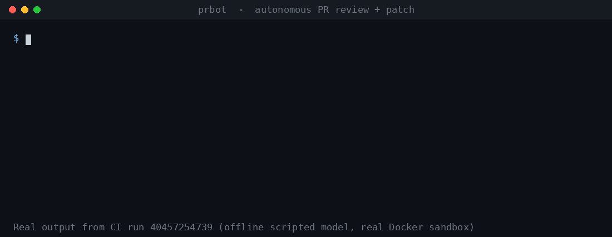
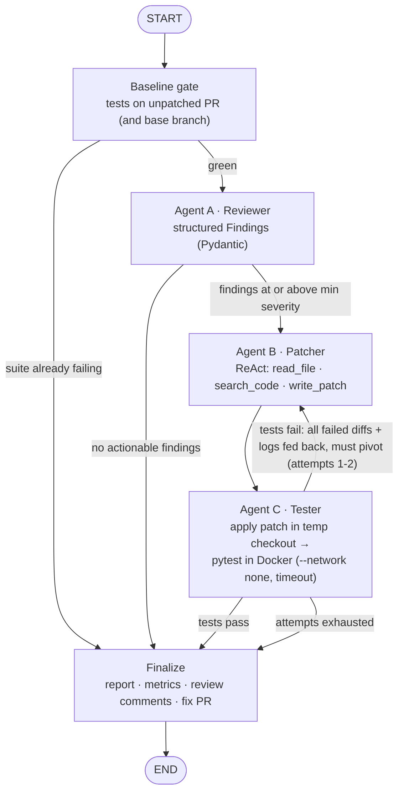

# prbot: Autonomous PR Review & Code-Patching Agent

[](https://github.com/ayanag5076-commits/prbot/actions/workflows/ci.yml)




A graph-based multi-agent system that reviews a pull request, writes a patch for the security and
performance bugs it finds, **proves the patch doesn't break the build** by running the test suite in a
network-isolated Docker container, and iterates on failures before anything is published to GitHub.



**Stack:** Python · LangGraph · LangChain tool calling · OpenAI (`gpt-4.1-mini` default) · Pydantic structured outputs · PyGithub (GitHub App auth) · Docker · Pytest

**Live demo target:** [ayanag5076-commits/prbot-demo-shop PR #1](https://github.com/ayanag5076-commits/prbot-demo-shop/pull/1)

## Use it on your repo in 2 minutes (GitHub Action)

1. Add an `OPENAI_API_KEY` secret (Settings -> Secrets and variables -> Actions).
2. Copy [`examples/prbot-review.yml`](examples/prbot-review.yml) to `.github/workflows/`:

```yaml
on: { pull_request: { types: [opened, synchronize, reopened] } }
permissions: { contents: read, pull-requests: write }
jobs:
  prbot:
    runs-on: ubuntu-latest
    steps:
      - uses: ayanag5076-commits/prbot@main
        with:
          openai-api-key: ${{ secrets.OPENAI_API_KEY }}
```

Every PR gets inline review comments, a verified `fix.patch` artifact, and the report in the job summary.
Set `open-fix-pr: "true"` (plus `contents: write`) to have prbot open a follow-up PR with the fix.
Secrets aren't exposed to workflows triggered from forks, so on public repos prbot reviews PRs from branches in the repo.

## System Benchmarks & Telemetry

The platform tracks and records execution safety metrics via a local JSONL telemetry engine to audit agent efficiency and resource overhead.

<!-- METRICS:START (regenerate: python -m prbot metrics --update-readme) -->
| Metric / Constraint | Baseline Target | Performance Realization | Verification Status |
| :--- | :--- | :--- | :--- |
| **Sandbox Network Egress** | 0 Bytes (Blocked) | 0 Bytes (`--network none`, `--cap-drop ALL`) | Verified via `test_sandbox_isolation` |
| **Self-Correction Recovery** | < 3 Attempts | **2 Attempts** (live gpt-4.1-mini: 3 bugs found, attempt 1 failed a test, attempt 2 passed) | Active Engine Runtime |
| **AST Diff Pre-Validation** | 100% Syntax Pass | Checked before any container run | Verified via `tools.py` |
| **Secret Leaks Detected** | 0 Key Escapes | 0 Variables Exposed | Verified via `tests/` CI guard |
| **P90 Execution Latency** | Under 45s | **10.03s** (2 Docker runs) | Met · `python -m prbot metrics` |
<!-- METRICS:END -->

How each row is produced:

- **Sandbox Network Egress:** Agent C runs tests with `--network none`, a read-only root FS, `--cap-drop ALL` and `no-new-privileges`. `tests/test_sandbox_isolation.py` asserts the flags on every run, and in CI a live container tries to open sockets to the internet and must report `EGRESS_BYTES 0`.
- **Self-Correction Recovery (live):** gpt-4.1-mini's first patch broke `test_duplicates_in_first_seen_order` (returned `['b', 'a']`); the failing assertion went back to Agent B, which rewrote the fix to keep first-appearance order and passed on attempt 2.
- **Self-Correction Recovery (offline demo):** the scripted first patch uses the MySQL `%s` placeholder, SQLite rejects it, the failure log goes back to Agent B, and attempt 2 switches to `?` and passes. The loop is capped at 3.
- **AST Diff Pre-Validation:** `write_patch` applies the diff in memory and `ast.parse`s every changed `.py` file. Broken patches go back to the agent as observations, so no container is spent on them.
- **Secret Leaks Detected:** `test_no_secrets_committed` scans the tree for OpenAI/GitHub tokens and private keys on every CI run. `.env`, `.env.*` and `*.pem` are git-ignored.
- **P90 Execution Latency:** end-to-end wall time per review (fetch, baseline, review, patch, sandboxed tests), taken from `prbot-out/metrics.jsonl` across Docker runs. Token cost per repair and Docker-vs-host overhead are tracked in the same ledger (`python -m prbot metrics --markdown`).

```bash
python -m prbot review --dry-run --path demo_repo --diff demo_repo/pr.diff --repeat 10   # 10 live runs (Docker + OpenAI)
python -m prbot bench-sandbox --path demo_repo --runs 10                                  # Docker vs host overhead
python -m prbot metrics --update-readme                                                   # fills the table above
```

## Reproduce the demo (no API key, no GitHub token)

```bash
git clone https://github.com/ayanag5076-commits/prbot.git && cd prbot
python -m venv .venv && source .venv/bin/activate
pip install -e ".[dev]"
python -m prbot review --repo ayanag5076-commits/prbot-demo-shop --pr 1 --dry-run --offline --no-docker
```

What that does: reads the public PR anonymously, runs the baseline tests, finds 3 seeded bugs, and runs the
real ReAct loop, patch validation and test runner. The first patch deliberately uses MySQL's `%s` placeholder in
SQLite, the tests fail, every failed diff and its log go back to the patcher, and attempt 2 passes. `--offline`
swaps the LLM for a heuristic reviewer and a scripted model. `--dry-run` guarantees nothing is written to GitHub.
Drop `--no-docker` once Docker is installed (`docker build -t prbot-tester:py3.12 -f docker/tester.Dockerfile .`).

```
status: patched | findings: 3 | attempts: 2/3
  [high    ] performance app/reports.py:10  N+1 query inside a loop
  [critical] security    app/users.py:7  SQL injection via f-string query
  [medium  ] performance app/users.py:14  Quadratic nested loop over the same sequence
  attempt 1: tests FAIL (exit 1, local)
  attempt 2: tests PASS (exit 0, local)
```

The full report (findings, self-correction table, verified diff, test logs) lands in `prbot-out/report.md`.

## How it works

The diagram at the top is the exact `StateGraph` in `prbot/graph.py`.


| Piece | What it does | Where |
|---|---|---|
| **State** | One Pydantic `ReviewState` flows through a LangGraph `StateGraph` | `prbot/models.py`, `prbot/graph.py` |
| **Baseline gate** | Runs the suite on the unpatched PR. If red, runs the base branch to attribute blame, then aborts with *"Review aborted: Main test suite is currently failing."* as a top-level PR comment | `baseline_node` in `prbot/graph.py` |
| **Agent A: Reviewer** | Context from the diff (hunks, numbered surrounding code, enclosing functions via `ast`) → `with_structured_output(Findings)`; drops hallucinated files/lines | `prbot/agents/reviewer.py`, `prbot/context.py` |
| **Agent B: Patcher** | Hand-rolled **ReAct loop** over native tool calling. `write_patch` validates the diff (applies, compiles, isn't a repeat of a failed patch) and returns errors as observations | `prbot/agents/patcher.py`, `prbot/tools.py` |
| **Anti-correction-loop** | `attempted_patches` history: every failed diff + log goes into the patcher's system prompt with "pivot to a structurally different solution"; exact repeats are rejected in-loop | `build_system` in `patcher.py`, `normalize_diff` in `tools.py` |
| **Agent C: Tester** | Copies the repo, applies the patch, runs pytest in Docker: `--network none --read-only --cap-drop ALL`, CPU/mem/pids limits, hard timeout + `docker kill` | `prbot/agents/tester.py` |
| **Patch engine** | Forgiving unified-diff applier: ignores wrong hunk counts, finds hunks by context, blocks path traversal | `prbot/patching.py` |
| **GitHub** | Fetch PR + tarball checkout of head and base; inline comments only on lines GitHub accepts; fix PR `prbot/fix-pr-N` **only if tests passed** | `prbot/github/client.py` |
| **Auth** | `GitHubAppAuth` (JWT → 1-hour installation token, per-run least privilege), `TokenAuth` (dev), `AnonymousAuth` (public dry runs) | `prbot/github/auth.py`, [docs/github-app.md](docs/github-app.md) |
| **Metrics** | Token usage and cost, recovery rate, sandbox overhead → JSONL ledger → README table | `prbot/metrics.py` |

## Security model

- **GitHub App, not PATs.** Installed per repository. Each run mints a token scoped to that repo with
  `contents:read` + `pull_requests:write`; `contents:write` is requested only for `--open-fix-pr`. Missing
  permissions fail fast. See [docs/github-app.md](docs/github-app.md).
- **Secrets stay local.** `OPENAI_API_KEY` and the App private key load from `.env` / a `.pem` outside the repo.
  `.env`, `.env.*` and `*.pem` are git-ignored, and `tests/test_session2.py::test_no_secrets_committed` fails the
  build if a key-shaped string or key file ever appears in the tree.
- **Untrusted test code is sandboxed:** no network, read-only root FS, dropped capabilities, resource limits, timeout.
- **Writes are opt-in:** `--post-review` / `--open-fix-pr` plus a confirmation prompt; `--dry-run` can never write;
  unverified patches are never pushed (saved as `unverified.patch`).

## Run against a real PR

```bash
cp .env.example .env     # OPENAI_API_KEY, PRBOT_GITHUB_AUTH=app, GITHUB_APP_ID, GITHUB_APP_PRIVATE_KEY_PATH
python -m prbot review --repo owner/name --pr 12                               # read-only, report to prbot-out/
python -m prbot review --repo owner/name --pr 12 --post-review                 # + inline review comments
python -m prbot review --repo owner/name --pr 12 --post-review --open-fix-pr   # + verified fix PR
python -m prbot review --dry-run --path ../some-repo --model gpt-4.1           # any local folder
```

Exit codes: `0` clean/patched, `1` patch failed verification, `2` usage error, `3` aborted by the baseline gate.

## Configuration

| Env var | Default | Meaning |
|---|---|---|
| `OPENAI_API_KEY` | | OpenAI key (local `.env` only) |
| `OPENAI_MODEL` | `gpt-4.1-mini` | any tool-calling chat model |
| `PRBOT_GITHUB_AUTH` | `token` | `app` (recommended), `token`, or `anonymous` |
| `GITHUB_APP_ID` / `GITHUB_APP_PRIVATE_KEY_PATH` | | GitHub App credentials |
| `GITHUB_APP_INSTALLATION_ID` | auto | otherwise discovered from `--repo` |
| `GITHUB_TOKEN` | | PAT fallback for local development |
| `PRBOT_MAX_ATTEMPTS` | `3` | patch → test iterations |
| `PRBOT_MIN_SEVERITY` | `medium` | findings below this are reported, not patched |
| `PRBOT_TEST_IMAGE` | `prbot-tester:py3.12` | tester image (bake test deps in; network is off) |
| `PRBOT_TEST_TIMEOUT` | `120` | seconds before the container is killed |
| `PRBOT_PRICE_INPUT` / `_CACHED` / `_OUTPUT` | | USD per 1M tokens for models not in the built-in price table |

## Tests

```bash
pytest     # offline suite (the live Docker egress test runs in CI)
```

Covers every conditional edge, the baseline abort and its PR comment, the attempt cap, failed-patch history and
repeat rejection, in-attempt recovery from bad diffs, GitHub App least-privilege token requests, comment placement,
metrics math, and the secret-leak guard.

## Design notes

- **Why a hand-rolled ReAct loop:** the stop condition is "a validated patch exists", and tool errors must come back
  as observations. ~40 lines, fully traceable (`tool_trace`), and token usage is counted per call.
- **Why validate inside `write_patch`:** most LLM patch failures are malformed diffs, not wrong logic. Catching them
  in-loop saves a full Docker run per mistake.
- **Why keep every failed diff:** models fall into correction loops, resubmitting variations of the same broken patch.
  The full history plus a pivot instruction and exact-repeat rejection break the loop.
- **Why a baseline gate:** if the suite is already red, no patch can turn it green; the agent would burn every attempt
  and tokens on code it didn't break.

## Layout

```
prbot/            agents/ (reviewer, patcher, tester) · github/ (auth, client) · graph · models · tools · patching
                  context · metrics · offline · cli
demo_repo/        seeded bugs (SQLi, N+1, O(n²)) + pytest suite + pr.diff (mirrors prbot-demo-shop PR #1)
docker/           tester image
.github/workflows ci.yml: tests, secret guard, live sandbox egress check, Docker demo run
docs/             github-app.md
tests/            offline unit + integration tests
```
